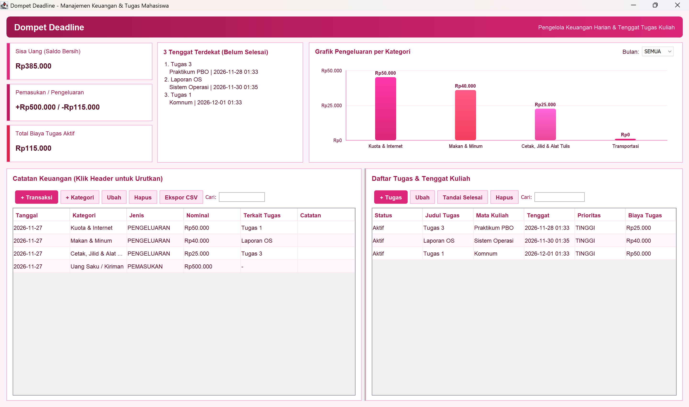

# Dompet Deadline

Aplikasi desktop berbasis **Java Swing** dan **SQLite** untuk membantu mahasiswa mengelola keuangan harian (pemasukan dan pengeluaran) sekaligus memantau daftar tugas kuliah beserta tenggat waktu dan total biaya pengeluaran yang terkait dengan setiap tugas dalam satu layar terpadu.

## Latar Belakang & Masalah yang Diselesaikan
Mahasiswa sering menghadapi dua masalah sekaligus menjelang akhir bulan: keterbatasan anggaran dan menumpuknya tenggat tugas kuliah. Pencatatan keuangan dan daftar tugas yang terpisah membuat biaya tersembunyi dari setiap tugas (seperti biaya cetak/print laporan, fotokopi, jilid, atau pembelian alat praktikum) sulit dilacak. **Dompet Deadline** menghubungkan setiap transaksi pengeluaran langsung ke tugas terkait sehingga pengguna dapat memantau sisa saldo, tenggat paling mendesak, serta akumulasi biaya tiap tugas secara real-time.

## Identitas Pengembang
- **Nama:** Najla Putri Syahnuza
- **NPM:** 250810701100115
- **Program Studi:** Informatika, FMIPA Universitas Syiah Kuala (USK)
- **Mata Kuliah:** Praktikum Pemrograman Berorientasi Objek (PBO)

## Tampilan Aplikasi


## Prasyarat & Spesifikasi Lingkungan
Pastikan perangkat memenuhi prasyarat berikut sebelum menjalankan atau membangun aplikasi dari kode sumber:

- **Java Development Kit (JDK):** Versi **11 atau lebih baru** (dikembangkan dan diuji pada **JDK 21**).
- **Apache Maven:** Versi **3.6.0 atau lebih baru** (untuk manajemen dependensi, pengujian otomatis, dan pengemasan executable `.jar`).
- **Sistem Operasi:** Windows, macOS, atau Linux dengan lingkungan desktop grafis (GUI) yang mendukung Java Swing dan `SystemTray` (jika `SystemTray` tidak tersedia, aplikasi otomatis beralih ke dialog notifikasi cadangan).
- **Koneksi Internet (Hanya saat Build Pertama):** Diperlukan sekali oleh Maven untuk mengunduh pustaka dependensi (`org.xerial:sqlite-jdbc` dan `org.junit.jupiter:junit-jupiter`). Setelah terunduh, aplikasi berjalan sepenuhnya secara **offline**.
- **Penyimpanan Lokal:** Izin baca/tulis pada direktori home pengguna (`~/.dompet-deadline/`) untuk menyimpan berkas database SQLite (`dompet_deadline.db`) secara otomatis.

## Fitur Utama
### Fitur Wajib
- **Manajemen Transaksi Keuangan & Kategori (CRUD):** Pencatatan transaksi pemasukan dan pengeluaran yang dapat dihubungkan ke tugas tertentu, lengkap dengan fitur tambah kategori baru (`PEMASUKAN` / `PENGELUARAN`) serta pengurutan (*sorting*) berdasarkan kolom tabel.
- **Manajemen Tugas & Tenggat Kuliah (CRUD):** Pengelolaan daftar tugas berdasarkan mata kuliah, waktu tenggat, prioritas (`TINGGI`, `SEDANG`, `RENDAH`), status penyelesaian, penyorotan merah otomatis untuk tugas terlambat, serta kalkulasi akumulasi biaya per tugas.
- **Dashboard Satu Layar:** Menampilkan kartu ringkasan Sisa Uang (Saldo Bersih), total arus kas masuk/keluar, total biaya dari tugas yang masih aktif, serta daftar **3 tenggat terdekat** yang belum selesai.
- **Visualisasi Grafik Pengeluaran:** Grafik batang kustom berbasis Java2D (`Graphics2D` via `paintComponent`) dengan filter pemilihan bulan untuk membandingkan pengeluaran per kategori.
- **Pengingat Tenggat Otomatis (`Timer` & `SystemTray`):** Pemeriksaan berkala menggunakan `javax.swing.Timer` yang memicu notifikasi desktop melalui `SystemTray` (atau dialog cadangan jika tidak didukung) untuk tugas belum selesai dengan tenggat $\le 24$ jam tanpa notifikasi berulang untuk tugas yang sama.
- **Ekspor Laporan CSV:** Mengekspor seluruh riwayat transaksi beserta keterkaitan tugasnya ke format `.csv` melalui `JFileChooser`.
- **Penyimpanan Permanen SQLite:** Seluruh data disimpan secara lokal di direktori pengguna (`~/.dompet-deadline/dompet_deadline.db`) menggunakan JDBC dan `PreparedStatement`.

### Fitur Bonus
- **Build & Manajemen Dependensi dengan Maven:** Konfigurasi `pom.xml` dengan `maven-shade-plugin` untuk menghasilkan berkas executable `.jar` mandiri.
- **Pencarian & Filter Real-Time:** Kolom pencarian langsung (*live search*) pada tabel Catatan Keuangan dan Daftar Tugas untuk menyaring data berdasarkan kategori, catatan, judul tugas, mata kuliah, maupun status.

## Arsitektur & Struktur Proyek
Proyek ini menerapkan pola arsitektur berlapis (*Layered Architecture*) agar logika antarmuka terpisah dari logika bisnis dan akses basis data:

```text
dompet-deadline/
├── docs/
│   └── screenshots/
│       └── dashboard.png              # Tangkapan layar aplikasi
├── src/
│   ├── main/java/com/dompetdeadline/
│   │   ├── Main.java                  # Titik masuk (entry point) aplikasi
│   │   ├── model/                     # Entitas domain (Kategori, Tugas, Transaksi)
│   │   ├── repository/                # Koneksi SQLite & akses data (JDBC + PreparedStatement)
│   │   ├── service/                   # Logika bisnis, validasi input, & kalkulasi keuangan/tenggat
│   │   └── ui/                        # Antarmuka Java Swing & grafik batang Java2D
│   └── test/java/com/dompetdeadline/
│       └── service/ServiceTest.java   # Unit test JUnit 5 untuk lapisan service
├── .gitignore                         # Daftar file/folder yang diabaikan Git (target/, *.db, dll.)
├── LICENSE                            # Lisensi perangkat lunak (MIT License)
├── pom.xml                            # Konfigurasi build Apache Maven
└── README.md                          # Dokumentasi proyek